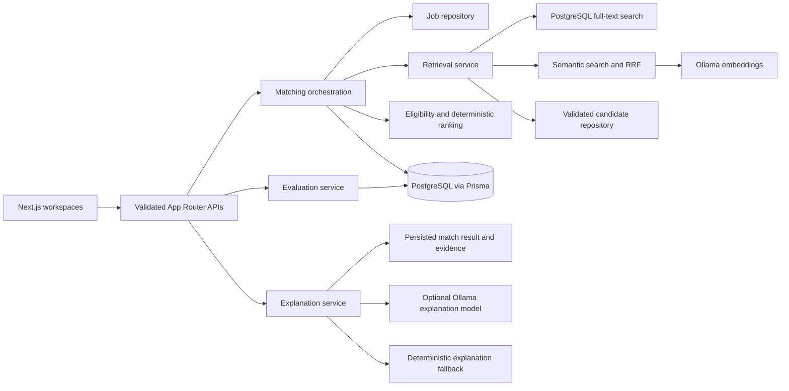

# End-to-end architecture and runtime behavior

TalentMatch AI is a single Next.js application backed by PostgreSQL, Prisma, and pgvector. It uses module boundaries inside one application; it does not use microservices, queues, Redis, Kubernetes, or a separate model server owned by this project. Ollama runs locally as an optional external process.

## System data flow

## Module responsibilities

- **Presentation:** `/`, `/matching`, `/candidates`, `/retrieval`, and `/evaluation` render actual system data. The matching workspace submits a request and displays ranked output and its saved trace link. Candidate Explorer renders normalized profile data and preserves each employment responsibility as its own list item.
- **API boundaries:** App Router handlers validate incoming JSON with Zod and translate known errors into structured JSON responses. Database and provider errors return general messages; internal stacks and profile text are not sent to clients.
- **Matching orchestration:** `executeMatching` validates the selected job through the repository, executes retrieval, resolves retrieved candidates against individually validated profile records, runs eligibility and ranking, persists the matching run and results, and returns the combined response. It calls the existing retrieval and ranking modules rather than reimplementing their rules.
- **Retrieval:** lexical search uses PostgreSQL full text; semantic retrieval uses the configured embedding provider and pgvector; hybrid retrieval fuses lexical and semantic ranks with RRF. Each successful strategy execution persists a `RetrievalRun`.
- **Domain rules:** `assessEligibility` keeps `PASS`, `FAIL`, and `UNKNOWN` distinct. `rankCandidates` uses configured signal weights and deterministic candidate-ID tie-breaking. Eligibility bucket order remains separate from suitability score.
- **Explanations:** `generateExplanation` loads one persisted `MatchResult`, builds a context from evidence already attached to that result, validates an optional Ollama response, and returns a deterministic fallback when necessary. It never reruns or modifies retrieval, eligibility, or ranking.
- **Evaluation:** `executeEvaluation` uses the existing manual judgments and retrieval/ranking services. It does not update judgments during a matching run.
- **Persistence:** Prisma handles relational data and run records. Parameterized raw SQL is limited to PostgreSQL full-text/vector operations that Prisma does not express natively.

## Matching flow and traceability

`POST /api/matching` accepts an existing `jobId`, retrieval strategy, top-K, optional weights, and optional assessment date. The service prepares the job query through the retrieval module, then produces lexical, semantic, or hybrid candidates. It assesses those candidates against the job requirements, computes five deterministic ranking signals, buckets by eligibility, and persists the result.

The response includes a matching run ID and creation time; the actual and requested retrieval strategies; a degradation reason if lexical fallback was used; embedding provider/model/digest/dimensions where available; RRF configuration; ranking weights; candidate retrieval ranks and strategy scores; eligibility requirements; signal scores and weighted contributions; and candidate-data quality counts. `GET /api/matching?runId={runId}` reconstructs that result from the `MatchRun`, linked `RetrievalRun`, and saved `MatchResult` records. The linked retrieval run stores the structured query, top-K, strategy result payload, provider metadata, duration, and creation time. The matching run stores the actual strategy, requested strategy, ranking configuration, assessment date, degradation status, data quality counts, and total duration.

The matching response's score and eligibility remain deterministic. LLM explanations are requested separately with `POST /api/explanations` and are not included in the ranking calculation or persisted matching result.

## API interfaces

| Method and path | Purpose |
| --- | --- |
| `GET /api/health` | Application and PostgreSQL readiness; returns 503 when the database check fails. |
| `POST /api/retrieval` | Run lexical, semantic, or hybrid retrieval and persist a `RetrievalRun`. |
| `POST /api/matching` | Run retrieval, eligibility, ranking, and persist a `MatchRun` and `MatchResult` records. |
| `GET /api/matching?runId={runId}` | Inspect a saved matching result and its linked retrieval trace. |
| `POST /api/explanations` | Generate or fall back to an evidence-grounded explanation for one saved result. |
| `GET /api/evaluation` | Return compact evaluation-run history. |
| `POST /api/evaluation` | Execute and persist a ranking/retrieval evaluation against existing judgments. |

`POST /api/matching` selects one of the persisted job descriptions. Custom job-description creation is not implemented; this keeps the current milestone within the approved synthetic dataset model. The request is schema-validated and the repository validates the stored job record.

## Failure behavior

- **Semantic or hybrid provider failure during matching:** the matching orchestrator retries the operation once using lexical retrieval only. It records the actual strategy as `lexical`, preserves the requested strategy and fallback reason, and displays a degraded-retrieval notice. A lexical failure or database failure is returned as an application error; hybrid is never reported as having succeeded when semantic retrieval did not run.
- **Standalone semantic/hybrid retrieval failure:** `POST /api/retrieval` returns a provider-unavailable error. It does not silently change the requested experiment to lexical.
- **Explanation failure:** unavailable/unconfigured Ollama, timeout, malformed output, incomplete output, invalid evidence references, or detected unsupported text produce a deterministic fallback. The saved match result remains unchanged.
- **Malformed candidate row:** candidate records are validated individually. An invalid record is excluded and logged with its ID and issue count, without logging its profile contents. Matching returns profile-quality counts; valid candidates continue through the pipeline. If the database itself is unavailable, the request fails without returning database details.
- **Evaluation ground truth:** evaluation reports incomplete/invalid judgments as an error. Matching itself does not write judgments.
- **Retries:** there are no general-purpose retries. The single explicit lexical fallback is the only retrieval degradation behavior.

## Logging and privacy

`src/modules/observability/logger.ts` emits one JSON record per event with timestamp, level, event name, and non-sensitive structured attributes. Matching requests use a correlation ID; completed runs include matching and retrieval run IDs. Provider failure events include strategy/provider/model and error type, not prompts or profile text. Candidate data-quality logs include candidate ID and validation issue count only. Database secrets, raw profiles, raw job descriptions, and exception stacks are not logged.

## Performance characteristics and limitations

Matching shares one candidate-pool load between semantic retrieval and ranking; it does not query the same candidate relation twice during a successful run. The current synthetic dataset contains 20 profiles, so semantic retrieval uses exact vector scans and creates embeddings in bounded batches. There is no approximate vector index or concurrent request coalescing. Two simultaneous first-time semantic runs can attempt to prepare the same embedding chunk; the database uniqueness constraint and upsert protect correctness, but duplicate embedding work may occur. No optimization beyond justified query reuse was added.

The current application is a learning showcase with no authentication, authorization, candidate consent workflow, or employment-data retention policy. Its deterministic eligibility/ranking heuristics and explanation text are demonstration tools, not hiring decisions. Ollama behavior has been tested with mocked boundaries; a live model must be configured separately to exercise actual generation.
