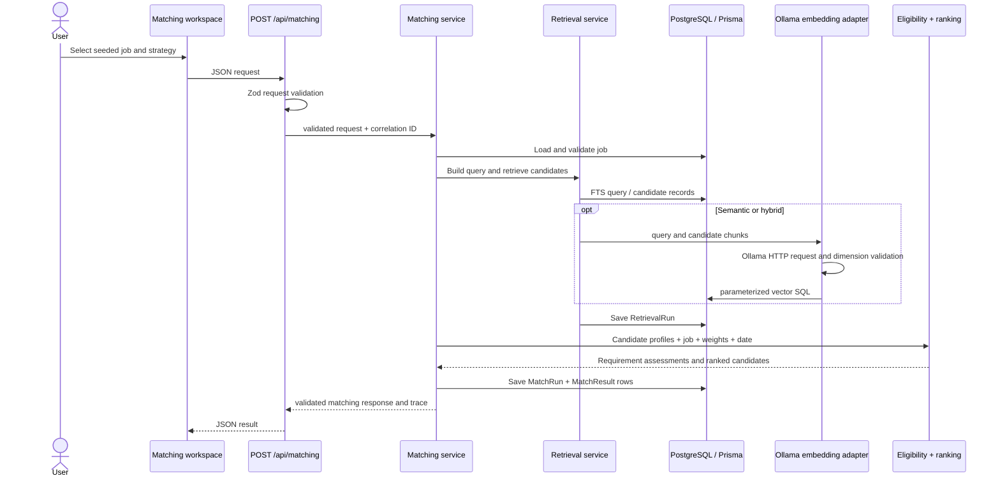

# Data flow and trust boundaries

## Retrieval and matching



## Explanation trust boundary

```mermaid
sequenceDiagram
  participant UI as Matching workspace
  participant API as POST /api/explanations
  participant Service as Explanation service
  participant DB as Persisted MatchResult
  participant Provider as Optional Ollama model
  UI->>API: runId, candidateId, jobId
  API->>Service: validated request
  Service->>DB: Read saved score, rank, eligibility and signals
  Service->>Service: Select only already attached evidence
  Service->>Provider: System instructions + JSON evidence context
  Provider-->>Service: Structured explanation candidate
  Service->>Service: Schema, ID, status and lexical-support checks
  alt accepted
    Service-->>API: source=ollama
  else unavailable or rejected
    Service->>Service: Create deterministic fallback
    Service-->>API: source=deterministic_fallback
  end
  API-->>UI: Explanation only; saved decision is unchanged
```

Candidate and job text crosses into the explanation provider as untrusted data. It is serialized separately from the system prompt, but this is prompt-injection mitigation, not a hard security sandbox. Explanation context is selected from persisted eligibility/ranking evidence rather than sending complete profiles. The validator verifies IDs and checks lexical overlap; it cannot prove semantic truth.

## Persistence and evaluation flow

Retrieval run data stores the query, strategy, provider/model metadata, duration, and structured result trace. A matching run references its retrieval run and stores ranking configuration; each match result stores the rank, score, eligibility class, and signals/evidence JSON. Evaluation loads the complete judgments for selected jobs, measures retrieval order, then optionally applies deterministic ranking to that same retrieved candidate set. It saves a separate append-only evaluation run.

The local Docker Compose PostgreSQL service uses a named volume. Database content is persistent across container stop/start. `docker compose down -v` removes that volume and its data; see [local setup](../development/local-setup.md).
