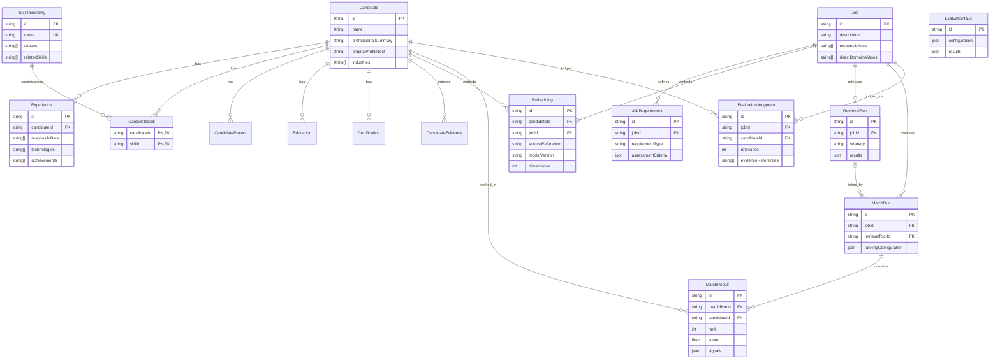

# Database design

PostgreSQL is the persisted source for synthetic profile/job records, embedding metadata and vectors, matching/retrieval traces, and relevance/evaluation runs. Prisma models relational tables and owns migrations. pgvector's vector field is added in SQL because Prisma's schema does not model the vector type or similarity operators; retrieval uses parameterized raw SQL for vector writes/search.

## Important modeling choices and constraints

- Candidate profile entities are normalized. `Experience.responsibilities`, technologies, achievements, industries, work preferences, and other source lists are PostgreSQL arrays where the application preserves list structure. Responsibilities are individual non-empty strings; Zod validates 3–6 per synthetic employment row and the migration enforces cardinality 3–6. They are not flattened in storage. Embedding preparation emits one responsibility chunk per statement.
- Skills use `CandidateSkill` as a join to unique `SkillTaxonomy` names. Taxonomy aliases/related skills are metadata, not proof of candidate proficiency.
- `CandidateEvidence` stores validated source references and supporting text. Assessment/result JSON also carries source references so a saved run's explanation can cite the evidence that was used at assessment time.
- `Embedding` Prisma model stores owner, provider/model/version, source reference, original chunk text/hash, and dimensions. The SQL migration adds `vector(768)` and checks dimensions/one owner. Its unique index is on candidate/source/provider/model/version; vector writes/reads are raw SQL.
- `RetrievalRun` stores query, strategy, top-K, optional RRF/provider metadata, duration, and result JSON. `MatchRun` references a retrieval run with `ON DELETE SET NULL`; `MatchResult` relates to run/job via a composite foreign key and candidate via its own foreign key.
- `EvaluationJudgment` is unique per job/candidate, has grade 0–3, rationale and evidence reference array. `EvaluationRun` stores configuration/results JSON plus counts and duration, with a creation-time index.
- Candidate child rows cascade on candidate deletion. Jobs own requirements and run histories by cascade. Skill taxonomy rows are protected from deletion while referenced. Relevant lookup indexes and uniqueness constraints are declared in Prisma/migrations; this is not an exhaustive operational index strategy.

## Schema limitations

`Embedding.vector` is absent from generated Prisma types, so relational metadata and vector content are split between Prisma and SQL. Evaluation result and matching signal payloads are JSON snapshots for reproducibility and flexible inspection; they are not individually queryable relational fields. The current vector column is fixed to 768 dimensions, so a different model dimension requires a migration. See [`prisma/schema.prisma`](../../prisma/schema.prisma) and SQL migrations under [`prisma/migrations`](../../prisma/migrations/).
