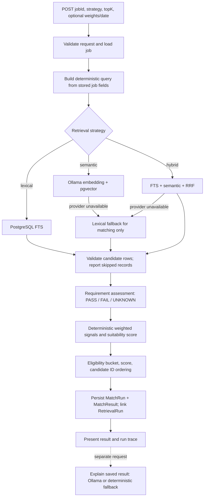

# Matching pipeline

The current matching request selects an existing seeded job by ID. It does not accept a new job description and does not use an LLM to extract requirements. The stored job's description and structured requirements are already prepared data.

| Stage | Input and processing | Output | Owner | Failure behavior |
| --- | --- | --- | --- | --- |
| Job selection | Existing `jobId`; job repository validates it. Description, requirements, responsibilities, work arrangement, seniority and experience expectation are already structured. | Stored `Job` domain value. | `POST /api/matching`, jobs repository. | Unknown job returns 404. No free-text extraction exists. |
| Query construction | Deterministically combines title/seniority, description, mandatory/preferred requirement text and evidence expectations, job responsibilities, industry and experience expectations. | Text and ordered query segments. | Retrieval query builder. | Invalid job records fail validation; no LLM fallback. |
| Lexical retrieval | Segment queries parsed with PostgreSQL `websearch_to_tsquery`, combined as OR against weighted candidate `tsvector` fields. | Ranked candidates and matched source evidence. | Lexical retrieval. | Database failure fails the matching request. |
| Semantic retrieval | Embed query through configured provider; compare to stored chunk vectors using cosine distance. | Candidate ranking with best matching evidence chunk. | Semantic retrieval + embedding adapter. | Provider error is typed; matching can fall back to lexical for provider-unavailable errors. Standalone retrieval returns an error. |
| Hybrid retrieval | Execute lexical and semantic at requested top-K; union and combine ranks via RRF. | RRF order, each strategy rank/score/contribution. | Retrieval service and RRF. | If semantic provider unavailable within matching, fallback is recorded as lexical; partial hybrid success is not claimed. |
| Candidate quality | Retrieved IDs resolved through candidate repository; each record schema-validated independently. | Valid profile set plus rejected count. | Candidate repository. | Invalid profiles skipped and counted; database errors fail the request. |
| Eligibility | Compare requirements to structured profile evidence and explicit criteria. | Requirement statuses and overall eligibility class. | `assessEligibility`. | Missing/partial evidence gives UNKNOWN, not FAIL. |
| Ranking | Calculate five normalized weighted signals, suitability sum, and deterministic order. | Scores, signal breakdown, evidence, rank. | `rankCandidates`. | Invalid weights/date fail schema/validation; no AI ranking fallback. |
| Persistence and result | Save match run, result rows, and retrieval link. | Traceable matching response and later GET result. | Matching service + Prisma. | Persistence failure fails the request; no success is returned without saved match output. |
| Explanation | Separate request reads one persisted result; validated Ollama output or deterministic fallback. | Explanation with supplied evidence IDs and source marker. | Explanation service. | Provider/validation failure falls back; saved ranking and eligibility remain unchanged. |
| Presentation | Matching workspace displays score, eligibility, signals, retrieval trace, and separately sourced explanation. | Inspectable result. | Next.js client UI. | API errors are shown as request failures; fallback result remains displayable. |

The saved trace is inspected with `GET /api/matching?runId={runId}`. The optional explanation is not part of the ranking operation: it cannot re-run retrieval, change a rank, or change eligibility. More implementation details: [retrieval](../engineering/retrieval-engine.md), [eligibility](../engineering/eligibility-assessment.md), [ranking](../engineering/ranking-engine.md), and [explanations](../engineering/explanation-engine.md).
