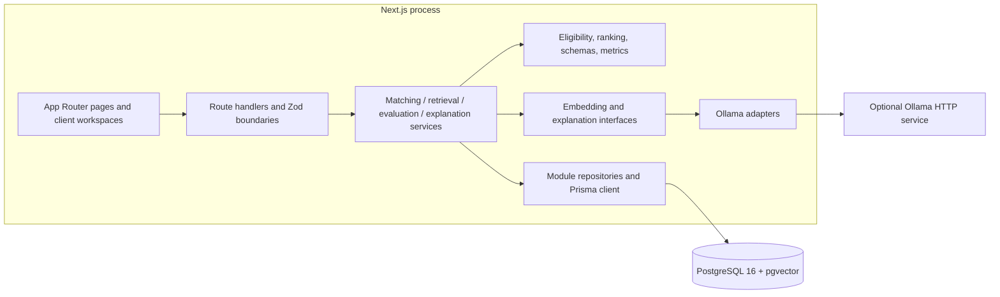

# System overview

## Runtime shape

TalentMatch AI is a single Next.js application (App Router) with TypeScript module boundaries. Server-rendered pages and client workspaces use route handlers under `src/app/api`. Application services call domain functions and repositories in-process. Prisma accesses PostgreSQL for relational data and run records; parameterized SQL handles PostgreSQL full-text search and pgvector operations. Ollama is an optional local process accessed over HTTP for embedding generation and explanation generation.

## Responsibilities and communication

- **Presentation** (`src/app`): renders the overview, candidate directory, matching, retrieval, and evaluation workspaces; sends validated JSON requests to local route handlers. UI components do not query Prisma directly.
- **API boundary** (`src/app/api`): parses request bodies or query parameters with Zod, invokes application services, maps known failures to HTTP status/error codes, and emits structured logs.
- **Application orchestration** (`src/modules/{matching,retrieval,evaluation,explanations}`): coordinates use cases, persistence, and calls to domain logic. Matching reads the chosen seeded job, retrieves a pool, assesses and ranks it, then persists the trace.
- **Domain logic** (`src/modules/assessment`, `evaluation/metrics.ts`, schemas): deterministic eligibility and ranking, evidence preparation, metric computation, and data validation. The core scoring and metrics functions can be tested without PostgreSQL.
- **Infrastructure** (`src/db`, `src/infrastructure`, module repositories): Prisma client, relational queries, SQL-specific full-text/vector operations, and Ollama HTTP adapters.
- **External services**: PostgreSQL is required for app data. Ollama is optional for semantic/hybrid retrieval and generated explanations. No cloud model API, queue, cache, or separate service is part of the current runtime.

The calls are ordinary function calls within one process, except for PostgreSQL and Ollama network requests. Route handlers are the HTTP boundary. A single Next deployment therefore owns presentation and server-side use cases; it is not a collection of independently deployable services.

## Why this fits the showcase

The active dataset is deliberately small and local. A modular monolith makes it possible to inspect end-to-end behavior and keep deployment and failure modes understandable while retaining module seams for retrieval, assessment, evaluation, and AI providers. PostgreSQL already supports the relational model, full-text search, and pgvector. Distributed infrastructure would add operational complexity without addressing a demonstrated workload need.

## Main HTTP interfaces

| Method | Path | Actual responsibility |
| --- | --- | --- |
| GET | `/api/health` | Executes `SELECT 1`; reports app and DB state, with HTTP 503 when DB is unavailable. |
| POST | `/api/retrieval` | Executes and persists a lexical, semantic, or hybrid retrieval run. |
| POST | `/api/matching` | Retrieves, assesses eligibility, ranks, and persists a matching run. |
| GET | `/api/matching?runId=…` | Reads a persisted matching result and linked retrieval trace. |
| POST | `/api/explanations` | Explains one saved result using Ollama or deterministic fallback. |
| GET / POST | `/api/evaluation` | Lists evaluation history / executes and persists an evaluation. |

Job input is selection by existing `jobId`; there is no free-text job creation endpoint. API request and response contracts are defined with module Zod schemas.

## System boundaries

Retrieval determines the candidate set and preserves retrieval evidence/ranks. Eligibility classifies job requirements. Ranking scores and orders candidates using deterministic signals, with eligibility classification as a separate ordering bucket. Explanations read persisted decisions and cannot modify them. Evaluation compares retrieval order or final ranking order against manually authored relevance judgments; it does not train a model or tune weights automatically.

For failure paths and current limitations, see [failure handling](../engineering/failure-handling.md) and [limitations](../limitations.md).
